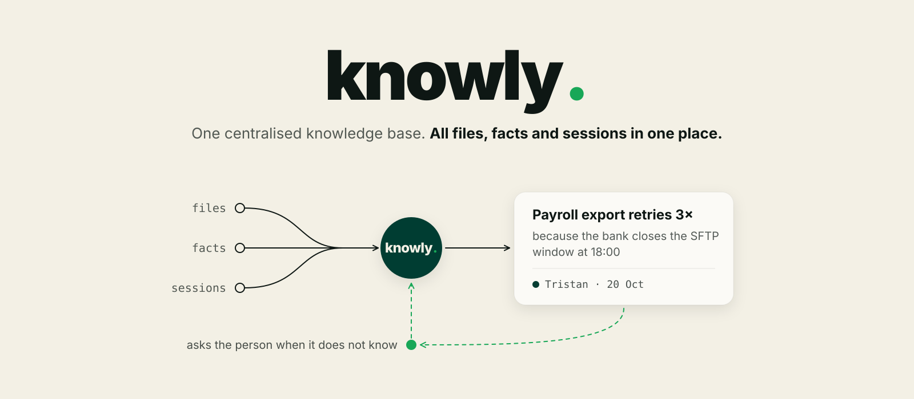
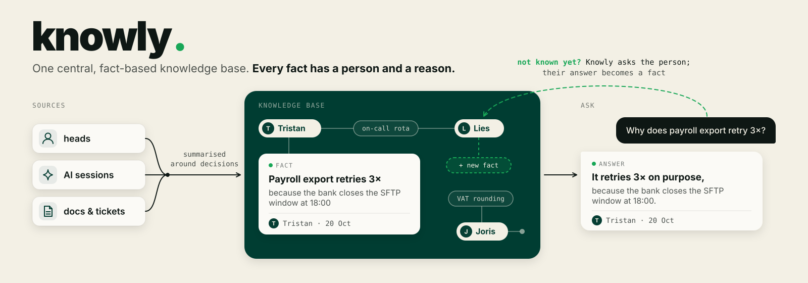

<p align="center">
  
</p>

Knowly is one centralised knowledge base. All files, facts and sessions sit in one place, and every fact has a person and a reason.

A lot of what a team knows sits in people's heads, and more and more of it is decided in conversations with AI. Those decisions disappear into chat history, and the documents that should hold them go out of date. Knowly fills the knowledge base from work people already do, and asks a person only when nobody wrote the answer down.

## How it works

<p align="center">
  
</p>

Knowly runs three loops.

1. **Capture.** A Claude Code hook picks up every session in the background. Claude summarises it around the decisions you made and why, quotes your own words for the reason, and stores the result as your fact. Raw sessions never leave your laptop.
2. **Ask.** Anyone asks in the `#ask-knowly` Slack channel, in a DM, or from Claude over MCP. The Knowly agent searches the knowledge base with its own tools and answers with the fact, the person behind it, their reason and the source session or question.
3. **Learn.** When the knowledge base has no answer, Knowly shows the closest related facts and tags the person most likely to know. They reply in the thread in their own words. Knowly turns the reply into a fact under their name and reacts with ✅. The next person who asks gets the answer straight away.

| Package | What it does |
|---|---|
| `knowly.capture` | Reads Claude Code sessions, scrubs secrets, summarises decisions, pushes facts (`knowly-record`, `knowly-hook`, `knowly-install`, `knowly-screenshots`) |
| `knowly.store` | The central fact store: facts per person with reasons, scoring that fades with time, gaps where a reason is missing |
| `knowly.agent` | The Knowly agent: Claude with search tools over the store (`search_facts`, `person_facts`, `recent_facts`) |
| `knowly.slack` | Slack bot: `#ask-knowly`, DM, `@knowly`, `/knowly`, and turning thread replies into facts |
| `knowly.ask` | One answer path shared by Slack, MCP and `POST /api/ask` |
| `knowly.server` | One service: the store API under `/store`, MCP at `/mcp`, `/api/ask`, `/healthz`, and the Slack bot |

## Demo

```bash
./demo/full_demo.sh          # add --reset for a clean start
```

The script starts Knowly, creates the demo members and stores one real Claude session as a fact. Then, in Slack:

1. Invite `@knowly` to `#ask-knowly`.
2. Ask: *"What time does the nightly payroll export start?"* Knowly answers that it is not recorded yet, shows the related fact about payroll retries and tags Tristan.
3. Tristan replies in the thread: *"16:00, so three retries still finish before the bank closes the SFTP window at 18:00."* Knowly saves it as his fact.
4. Ask again. Knowly answers with 16:00, Tristan and his reason.

[demo/README.md](demo/README.md) has the full stage script and the MCP variant.

## Quickstart

```bash
uv venv --python 3.13
uv pip install -e '.[dev]'
export KNOWLY_ADMIN_TOKEN=$(openssl rand -hex 24)

knowly-server                      # the store, API and MCP on port 8091
slack run                          # same server plus the Slack bot, uses manifest.json
```

Create a member and send your sessions:

```bash
curl -X POST localhost:8091/store/members -H "Authorization: Bearer $KNOWLY_ADMIN_TOKEN" -d '{"person": "you"}'
knowly-record --person you --push http://127.0.0.1:8091 --token=<member token>      # backfill
knowly-install --person you --push http://127.0.0.1:8091 --token=<member token> --write-settings   # live hook
```

Ask from Claude Code:

```bash
claude mcp add --transport http knowly http://127.0.0.1:8091/mcp --header "Authorization: Bearer $(knowly-token you)"
```

## Configuration

| Variable | Default | Meaning |
|---|---|---|
| `KNOWLY_DATA_DIR` | `./data` | Where every database file lives |
| `KNOWLY_ADMIN_TOKEN` | | Admin token for creating members (at least 32 characters) |
| `KNOWLY_URL` | `http://127.0.0.1:$PORT` | The server's own address, used by the agent and recorders |
| `KNOWLY_CHANNEL` | `ask-knowly` | The Slack channel Knowly listens to |
| `KNOWLY_ALLOW_SELF` | `0` | `1` lets one Slack account ask and answer (single-account demos) |
| `SLACK_PEOPLE` | | `name:Uxxx,...` to map people to Slack users |
| `PORT` | `8091` | HTTP port |
| `SLACK_BOT_TOKEN`, `SLACK_APP_TOKEN` | | Set by `slack run` |

## Privacy and security

- Raw sessions stay on the laptop. Only the summary of your decisions is sent.
- Secrets, tokens and email addresses are scrubbed before anything leaves the machine.
- Quotes in a summary are checked against what you actually typed.
- The person behind a fact always comes from their token or Slack identity, never from the request.

## Layout

```
src/knowly/   capture, store, agent, slack, ask, server
tests/        test suite (offline)
demo/         one-command demo setup and stage script
assets/       images
app/          team web app
```

## Unfinished

- Claude runs through the `claude` CLI with a logged-in account. A server deployment needs an API key instead.
- SQLite storage, so one instance at a time.
- Bearer tokens, no single sign-on.
- Answers are not cached, so every question costs a Claude call.

Built at the Tectonic Hackathon final (SD Worx track) by the Packoverflow team.
