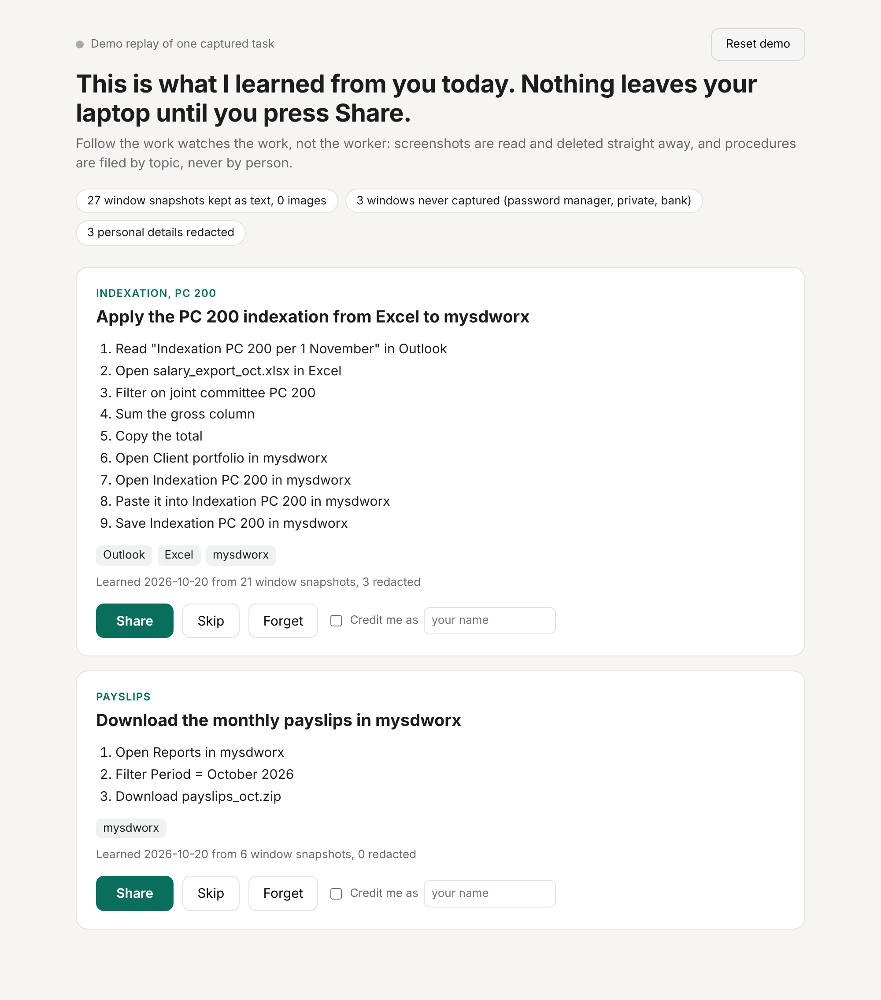

# Follow the work

A local recorder that watches how someone does a manual task on their Mac (open the export, filter, copy the total, paste it into mysdworx), turns it into a short step-by-step procedure, and lets the person review it before anything is shared. Shared procedures go to `out/procedures.json`, which is the whole interface to the team knowledge base.

**It watches the work, not the worker.** Screenshots are OCR'd and deleted at once. Everything stays in `local/` (gitignored) until the person presses Share. Procedures are keyed by topic and task, never by person: no per-person query, no score, no timeline, and `captured_at` is a date only. Credit is added only if the person ticks "Credit me as".



## Run the demo (any machine, Python 3 standard library only)

```bash
cd ideas/arend
python3 -m followwork.review --demo     # http://127.0.0.1:8765
```

The demo replays `fixtures/frames.json` (what the capture loop would have seen during a PC 200 indexation task, with an IBAN, emails, a password manager, a private window and a bank mixed in) through the same capture rules, extractor and review code as live capture. Press Share and the item lands in `out/procedures.json`. Reset demo wipes `local/` and the demo items in the output and replays the fixtures.

## Run it for real (Mac)

```bash
cd ideas/arend
bash mac/build.sh                 # compiles the Swift helper (Vision OCR, front window, clipboard)
bash mac/ocr_spike.sh ~/Desktop/spike   # step 1: OCR ~10 window shots of a real task, see if steps are nameable
python3 mac/capture.py            # step 2: prints "● recording"; p + Enter pauses, q stops, or touch PAUSE
python3 -m followwork.review      # review today's capture, press Share
```

`capture.py` needs Screen Recording permission for your terminal (System Settings, Privacy & Security, Screen Recording). macOS asks on the first window title read or screenshot; grant it and restart the terminal.

## Rules

- `allowlist.txt`: only these apps are captured.
- `blocklist.txt`: app or title words that are never captured (password managers, private/incognito windows, banks). Checked before any screenshot is taken.
- Redaction (`followwork/redact.py`) before anything touches disk: emails, IBAN, card numbers (Luhn), Belgian national numbers, token and key shapes.
- Clipboard is read only in allowlisted windows, and is dropped when a password manager marks it concealed.
- `FOLLOW_WORK_CLAUDE=1` plus `ANTHROPIC_API_KEY` lets Claude polish step names. Off by default, cached, falls back to rule names, and only sees the rule-based names, never OCR text.

## Output shape

```json
{"id": "proc-b4613a5b1f", "topic": "indexation, PC 200",
 "title": "Apply the PC 200 indexation from Excel to mysdworx",
 "steps": ["Read \"Indexation PC 200 per 1 November\" in Outlook", "Open salary_export_oct.xlsx in Excel",
           "Filter on joint committee PC 200", "Sum the gross column", "Copy the total", "..."],
 "apps": ["Outlook", "Excel", "mysdworx"], "captured_at": "2026-10-20", "source": "screen"}
```

`credit` is present only when the person chose it.

## Tests

```bash
python3 -m unittest discover -s tests -v
```

Redaction (IBAN, email, tokens, card, national number), step grouping, and a demo replay check that nothing private is stored. `tests/without_logic.txt` is the run against stub functions (8 of 10 fail), `tests/with_logic.txt` the run with the real logic.

## What is verified and what is not

- Verified in a Linux cloud container, on fixtures only: redaction, capture rules, step extractor, review screen, Share, Skip, Forget, Reset and `out/procedures.json`.
- Not run yet: everything in `mac/` (Swift helper, OCR spike, capture loop). It was written without a Mac, so the first run may need small fixes.
- The big open risk is step 1: whether Vision OCR of real windows gives text good enough for these naming rules. The rules were written against fixture text.

## Unfinished

- Step naming rules are tuned to one payroll flow (filter, sum, copy, paste, save, download). Other tasks fall back to "Open X in App".
- Private browser windows are detected by title only; a Safari private window title does not say "Private".
- No multi-day history: the review screen shows whatever is in `local/events.jsonl`.
- No merge of the same procedure learned twice; the id is a hash of topic and title, so a repeat replaces the earlier share.
